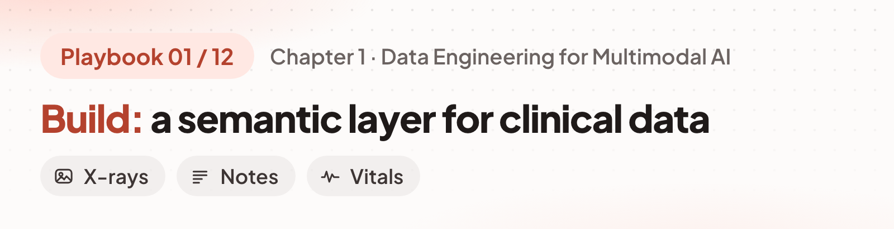
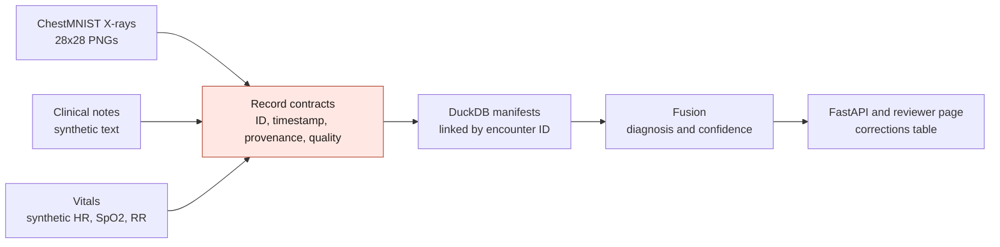

<picture>
  <source media="(prefers-color-scheme: dark)" srcset="docs/img/header-dark.png">
  
</picture>

# Playbook 01: Link an X-ray, a note and vitals into one clinical event
**How to build a semantic layer for multimodal data.** Chapter 1 of [*Data Engineering for Multimodal AI*](https://oreil.ly/data-engineering-multimodal) (O'Reilly, 2026), pages 20–31.

[](https://github.com/Data-Engineering-for-Multimodal-AI/playbook-01-multimodal-ai-semantic-layer/actions/workflows/smoke.yml)

[](LICENSE)
[](https://codespaces.new/Data-Engineering-for-Multimodal-AI/playbook-01-multimodal-ai-semantic-layer?quickstart=1)

An X-ray, a physician's note and ICU vitals about the same patient can't be used together unless something ties them to the same event. In this repo, we explore this with a single clinical case: one X-ray, one note and a set of vitals. Follow along to give all three a shared contract, fuse them into one event, and serve an AI proposal with its evidence to a reviewer who can confirm or correct it.

**The problem.** Each modality can be correct on its own and still be useless together, because nothing says which X-ray, note and vitals belong to the same patient at the same moment.

**What you'll work with.** You'll build a small semantic layer: a shared contract that gives every record an ID, a timestamp, its source and a quality flag, so the three can be aligned, fused and checked by a person.

> Following the book? Its Steps 1–4 are in [Run it the way the book does](#run-it-the-way-the-book-does) and still work as printed. Want the code exactly as printed? Use the `first-edition` tag. This branch is the 2026 maintenance update; see [Differences from the printed book](#differences-from-the-printed-book).

## Run it

You need [uv](https://docs.astral.sh/uv/) and `make`. No Docker, no Git LFS, no API keys. Or open the repo in a GitHub Codespace, where both are ready. On Windows without `make`, use a Codespace or the book's steps below.

**1. Get the code.** About 4 MB.

```bash
git clone https://github.com/Data-Engineering-for-Multimodal-AI/playbook-01-multimodal-ai-semantic-layer.git
cd playbook-01-multimodal-ai-semantic-layer
```

**2. Build the semantic layer.** Installs the locked dependencies (`uv sync`), ingests the 50 X-rays, notes and vitals files into DuckDB (`python main.py --ingest`) and prints four fused events (`python test_system.py`). On a Mac the first run took 53 s, most of it creating the Python environment; later runs took 2 s.

```bash
make run
```

You should see 50 records per modality, no contract violations, then the fused events:

```
- Images processed: 50
- Notes processed: 50
- Vitals processed: 50
- Contract violations: 0
...
   Encounter: enc_00006
   Diagnosis: infiltration
   Confidence: 0.66
   Evidence sources: 3
```

**3. Start the API.** Runs `python main.py --server` on port 8000. Leave it running.

```bash
make serve
```

You should see `Application startup complete.`

**4. Ask for an event and correct it.** In a second terminal. This calls `GET /event/{encounter_id}`, the same request as the book's curl example:

```bash
make event ID=enc_00007
```

```
    "encounter_id": "enc_00007",
    "diagnosis": "infiltration",
    "confidence": 0.6633333305517832,
    ...
            "findings": [
                "infiltration",
                "pneumothorax",
```

The X-ray of `enc_00007` is labelled with four conditions; the layer proposes the first one. Open http://localhost:8000/reviewer/enc_00007 to see the X-ray, the note and the vitals side by side, and send a correction from the form, or with curl:

```bash
curl -X POST http://localhost:8000/corrections -H "Content-Type: application/json" \
  -d '{"encounter_id": "enc_00007", "diagnosis": "pneumothorax", "confidence": 0.9, "corrections": {"reason": "Reviewer read the X-ray"}}'
```

```
{"message":"Correction saved successfully","encounter_id":"enc_00007"}
```

The correction goes into the `corrections` table. Ask for the event again and it still says `infiltration`: nothing reads that table yet (see [Before production](#before-production)). Try other IDs from `enc_00001` to `enc_00050`, or list them at http://localhost:8000/encounters.

**5. Clean up.** Stop the API with Ctrl+C, then:

```bash
make clean
```

This deletes `data/processed/` (the DuckDB file, with any corrections you sent), `static/images/` and the test cache. The sample data in `data/raw/` stays.

## How much time do you have?

| Time | What to do |
|---|---|
| 15 minutes | [Run it](#run-it), steps 1 to 4. On a Mac, step 2 took 53 s the first time and 2 s after that. |
| 1 hour | The three [Try this](#try-this) experiments (under 1 minute each on a Mac), then open a few encounters in the reviewer page and compare the note with the X-ray labels. |
| 1 day | [Use your own data](#use-your-own-data): build a folder of your own encounters, make it pass the checks, then work through [Before production](#before-production). |

## Try this

Each experiment changes one thing and measures the effect. They work on copies of `data/raw/` in a temporary folder, each with its own DuckDB file, so they leave your database alone and run while `make serve` is up. No Docker, no network. The numbers below are from a Mac on 2026-11-21.

**1. What happens when a modality is missing?** Deletes the note, the vitals or both for 10 of the 50 encounters, ingests each copy and asks the fusion engine (the code behind `GET /event/{id}`) for every event.

```bash
make try-missing
```

```
Case                           events built failed  error             confidence (complete) (incomplete)
nothing missing                    50    50      0  -                                 0.663            -
10 notes missing                   50    50      0  -                                 0.663        0.697
10 vitals missing                  50    40     10  TypeError                         0.663            -
10 notes and vitals missing        50    40     10  TypeError                         0.663            -
```

Every complete encounter gets the same confidence, 0.663, because the quality scores are fixed per modality. An encounter without a note gets a higher confidence (0.697) than a complete one, because confidence is the mean of the evidence that is there. An encounter without vitals can't be served at all: the API returns HTTP 500 for it. Change the confidence formula in `fuse_event()` in `src/semantic_api.py` and run it again.

**2. Which bad records does the contract catch?** Makes one bad file at a time and checks whether ingestion skips it, whether the record contract in `src/models.py` counts a violation, and what the event looks like afterwards.

```bash
make try-contract
```

```
Bad input                              skipped with error contract violation  event afterwards
image name with 13 labels                             yes                 no  enc_00003: 404 not found
image not named chestmnist_sample_*                   yes                 no  enc_00003: 404 not found
image file is not a PNG                                no                 no  enc_00003: built (image+note+vitals)
note is empty                                          no                 no  enc_00003: built (image+vitals)
note is not UTF-8 (Latin-1)                           yes                 no  enc_00003: built (image+vitals)
note for an encounter with no image                    no                 no  enc_00099: 404 not found
vitals SpO2 of 150%                                    no                 no  enc_00003: built (image+note+vitals)
vitals without an spo2 column                          no                 no  enc_00003: 500 KeyError
vitals recorded in 1999                                no                 no  enc_00003: built (image+note+vitals)
```

None of the nine bad inputs is counted as a contract violation. The contract checks only that the IDs are set, the modality name is known and quality is between 0 and 1, and the pipeline fills those fields itself. Three files are skipped with a message the summary doesn't count, two are dropped without a message, three are served as if nothing were wrong, and one breaks the event. Add a check to `RecordContract.__post_init__` (for example, SpO2 at most 100) and run it again.

**3. One INSERT per record, or one per table?** The pipeline writes each record with its own `INSERT`. This builds 500, 2,000 and 5,000 encounters from copies of the samples and ingests each set twice: as the pipeline does it, and with the same rows written in one `INSERT` per table. It checks that both give the same row counts.

```bash
make try-scale
```

```
encounters    rows one INSERT per record one INSERT per table  faster
       500   2,000                 1.15s                0.21s    5.6x
     2,000   8,000                 2.74s                0.64s    4.3x
     5,000  20,000                 7.14s                2.36s    3.0x
```

Writing each table at once was 3 to 6 times faster on the Mac, which was running other work at the time, so its times varied between runs. In CI (ubuntu-latest, Python 3.13) the same run gave 1.36 s against 0.13 s for 500 encounters and 13.16 s against 0.79 s for 5,000: 10 to 17 times faster, and the gap grew with the number of encounters. Pass other sizes with `make try-scale SIZES="100 10000"`.

## Use your own data

Put your encounters in a folder with the same layout and file names as `data/raw/`:

```
my_encounters/
  images/  chestmnist_sample_000_label_[0 0 0 1 0 1 0 0 0 0 0 0 0 0].png   -> enc_00001
  notes/   enc_00001_note.txt       UTF-8 text (optional)
  vitals/  enc_00001_vitals.csv     columns ts,hr,spo2,rr; one per image
```

The number after `sample_` is the image number: image N becomes encounter `enc_{N+1}`, padded to five digits. The 14 labels are 0 or 1, in the order listed under [Project structure](#project-structure). Vitals timestamps are ISO 8601 (`2025-09-22T19:03:48`), one reading per line.

Check it first. This reads every file and writes nothing:

```bash
make check-data DIR=my_encounters
```

It reports every file the pipeline would skip, drop or fail on. On a test folder with mistakes in it:

```
5 encounters in my_encounters: 5 images, 2 notes, 4 vitals files
  note: enc_00002: no note; its event will have image and vitals evidence only
  ...
9 problem(s):
  images/chestmnist_sample_002_label_[0 0 0 0 0 0 0 0 0 0 0 0 0 0].png: not a PNG image
  images/chestmnist_sample_003_label_[0 0 0 1].png: needs 14 labels of 0 or 1 in the name, found 4: [0 0 0 1]
  images/xray.jpg: not a .png file; ingestion would skip it
  notes/enc_00005_note.txt: not UTF-8 text (save it as UTF-8)
  vitals/enc_00002_vitals.csv: missing column(s) spo2; needs ts,hr,spo2,rr
  vitals/enc_00005_vitals.csv: line 3: timestamp 2025-09-22T19:03:47 is not after the line before
  vitals/enc_00005_vitals.csv: line 3: spo2 150 is outside 50-100
  images/chestmnist_sample_009_label_[0 0 0 0 0 0 0 0 0 0 0 0 0 0].png: no vitals/enc_00010_vitals.csv; GET /event/enc_00010 would fail
  notes/enc_00042_note.txt: no image for enc_00042; it would never appear in an event

Fix or remove these files and run again. Nothing was written.
```

It also catches Git LFS pointers, empty files, values that aren't numbers, and two images that map to the same encounter. When everything passes, stop `make serve` and load it:

```bash
make load DIR=my_encounters
make serve
```

```
All files passed the checks.
...
Loaded 2 encounters into data/processed/granite_lite.db. Start the API with make serve and open http://localhost:8000/reviewer/enc_00001
```

`make load` replaces the database with your encounters, as `python main.py --ingest` does for the samples, and copies your images to `static/images/` for the reviewer page. `make run` puts the samples back.

## What you end up with

A semantic layer over your own encounters: X-rays, notes and vitals linked by one ID, fused into events with their evidence and lineage, served by an API and a reviewer page, with a checker that tells you which files would break it.

Skills you'll practice:
- Giving records from different modalities a shared contract (ID, timestamp, source, quality)
- Linking modalities by a shared key and seeing what a left join drops
- Fusing evidence into one event and recording its lineage
- Keeping a person in the loop with a review and correction page
- Validating input files before they reach the pipeline
- Measuring a pipeline before changing it

## Before production

This playbook runs on one machine with 50 sample encounters. Before you run something like it for real:

1. **Make the contract check the data.** `RecordContract` checks IDs, the modality name and that quality is in [0, 1], and the pipeline sets those itself. None of the nine bad inputs in [Try this 2](#try-this) was counted as a violation. Check value ranges, required columns and encodings at ingestion, and count every skipped file. *Chapter 4, "Validation, Transformation, Observability, and Annotation Across Modalities" (page 119).*
2. **Handle a missing modality.** An encounter without vitals returns HTTP 500 (`os.path.exists(None)` in `get_vitals_summary`), and one without a note gets a higher confidence than a complete one ([Try this 1](#try-this)). Decide what a missing modality means, and serve the event with what is there. *Chapter 12, "Resilient Operation Under Modality Failure" (page 490).*
3. **Use the time the data was recorded.** Every record gets `timestamp=datetime.now()` at ingestion. The vitals carry their own times (`ts`), and the X-rays and notes carry none, so nothing can tell whether the three come from the same moment. Store event time and check that the modalities fall in one window. *Chapter 1, "Integration and Synchronization" (page 14); Chapter 7, "Event-Time Alignment" (page 218).*
4. **Link by more than a file name.** The encounter ID comes from the image's file name (`sample_005` becomes `enc_00006`); a renamed file links to the wrong patient or to nobody, and a note with no image is dropped by the left join without a message. *Chapter 1, "Entity Resolution and Why It's Hard" (page 12).*
5. **Measure quality instead of fixing it.** Quality is 0.95, 0.85 and 0.90 for every image, note and vitals file, so every complete encounter gets confidence 0.663. Compute it from the data (image resolution, note length, gaps and out-of-range vitals). *Chapter 1, "Building the Semantic Layer: A Step-by-Step Summary" (page 12).*
6. **Use the corrections.** `POST /corrections` stores a row that nothing reads: the event and the reviewer page show the original diagnosis after a correction, and the reviewer is always recorded as `human_reviewer`. Show the latest correction, record who made it, and use corrections as labels. *Chapter 4, "Annotation: Where Multimodal Systems Mature or Collapse" (page 123).*
7. **Write in batches and add instead of rebuilding.** Ingestion drops and rebuilds every table and writes one row per `INSERT`; one `INSERT` per table was 3 to 6 times faster on a Mac and 10 to 17 times faster in CI ([Try this 3](#try-this)). Load new encounters incrementally. *Chapter 1, "Processing at Scale" (page 15).*
8. **Lock down the API and the data.** There is no authentication, the static folder serves every X-ray to anyone who knows the name, and DuckDB allows one writer process, so `make load` can't run while the API is up. For real patient data you need access control, audit logs and a database that serves many clients. *Chapter 11, "Protecting Data Across the Pipeline" (page 421); Chapter 11, "Lineage and Provenance Tracking" (page 416).*

## What it costs

| Where you run it | Cost |
|---|---|
| Your machine | $0. Everything runs locally: no API keys, no paid services. About 150 MB of disk, most of it the Python environment. |
| A GitHub Codespace (2 cores, 8 GB, the default size; the repo asks for nothing larger) | Estimated $0.18 per hour at GitHub's list price (November 2026). A free personal account includes 120 core-hours a month, about 60 hours on this machine. In CI, `make run` took 2 s in a freshly built devcontainer. |

## How it works



The code calls the semantic layer Granite Lite. It fuses three modalities for 50 encounters:

- **Images**: 50 ChestMNIST chest X-ray thumbnails (28×28) with their 14 diagnostic labels
- **Text**: clinical notes, **synthetic**, generated from each image's labels by `generate_raw_data.py`
- **Time-series**: vital signs (HR, SpO2, RR at 1 Hz for 2 minutes), **synthetic**, from the same script

How the pieces fit, as the code implements them:

- **Linking modalities.** Each image file `chestmnist_sample_NNN_…png` becomes encounter `enc_{NNN+1}` (so `sample_005` → `enc_00006`). Notes and vitals carry the same encounter ID in their file names. Linking is by this shared ID; there is no fuzzy entity resolution.
- **Contracts.** Every record must carry `entity_id`, `encounter_id`, `modality`, `timestamp`, `provenance` and `quality` in [0, 1] (`src/models.py`). Violations are counted.
- **Quality scores** are fixed per modality (image 0.95, note 0.85, vitals 0.90). They show where a real quality metric would plug in.
- **Fusion.** The diagnosis is the first active image label. Confidence is the mean of the per-modality evidence scores (quality × 0.9 / 0.7 / 0.6).
- **Storage.** DuckDB, with `image_manifest`, `note_manifest`, `vitals_manifest` and the joined `curated_manifest`. Ingestion rebuilds them on each run.
- **API.** FastAPI: `GET /event/{encounter_id}`, `GET /encounters`, `POST /corrections`, and `GET /reviewer/{encounter_id}`, a web page for human-in-the-loop corrections.

## Run it the way the book does

These are the book's Steps 2–4 (pages 24–30), as printed apart from the fixes in [Differences from the printed book](#differences-from-the-printed-book). Step 1 (page 22) looks at the files in `data/raw/`.

```bash
pip install -r requirements.txt     # Python 3.12 or newer
python main.py --ingest
python main.py --server
```

Then open:
- **API**: http://localhost:8000
- **Reviewer UI**: http://localhost:8000/reviewer/enc_00001
- **API docs**: http://localhost:8000/docs

Using [uv](https://docs.astral.sh/uv/) instead:

```bash
uv sync
uv run python main.py --ingest
uv run python main.py --server
```

Run the end-to-end check (about 20 seconds on a laptop, no network after install): `make smoke`

Other entry points: `python test_system.py` prints fused events from the database; `python demo.py` and `./start.sh` ingest if needed, then start the server.

The `make` targets in [Run it](#run-it) run these same commands: `make run` is `python main.py --ingest` plus `python test_system.py`, and `make serve` is `python main.py --server`.

## Tested on

| Date | OS | Python | Key libraries |
|---|---|---|---|
| 2026-10-12 | macOS 26.5.1 (arm64) | 3.12.15, 3.13.16 | fastapi 0.143.0, starlette 1.7.0, uvicorn 0.54.0, duckdb 1.5.6, pydantic 2.14.1, pandas 3.0.6, numpy 2.5.4 |
| CI, on every push | ubuntu-latest | 3.12, 3.13 | same, from `uv.lock` |

## Differences from the printed book

| What changed | Why | Book page |
|---|---|---|
| `requirements.txt` now exists (pinned, exported from `uv.lock`). Python 3.12+ required | The file was missing, so the install in Step 2 failed | 24 |
| `python main.py --ingest` rebuilds the database on each run, and the database is no longer committed | Re-running added duplicate rows (450 curated rows for 50 encounters on a fresh clone) | 24–26 |
| Reviewer UI works on current FastAPI/Starlette | Starlette 1.0 removed the old template call; the page returned HTTP 500 | 26–30 |
| `python main.py --setup` works (alias for `--ingest`) | `start.sh` and `demo.py` called a flag that didn't exist | n/a |
| `static/images/` is filled by `--ingest` instead of being committed | Generated copy of `data/raw/images/` | n/a |
| `generate_raw_data.py --seed` (default 42) | Regeneration is now repeatable. The committed notes and vitals predate the seed, so regenerating gives different text and values from the repo's files | n/a |
| The 11 notes that list findings name the image's conditions; the generator's term list follows the ChestMNIST label order | The term list was in a different order, so every listed finding contradicted the image labels (for example, `enc_00014` is labelled cardiomegaly and its note said "consolidation"). Only the finding words changed; the rest of each note is as committed | 24 |
| This README describes linking as a shared encounter ID from file names and says that notes and vitals are synthetic | Match what the code does | 21, "entity resolution linking modalities" |

This section is the record of changes since printing. Full list: [CHANGELOG.md](CHANGELOG.md).

## Data and licenses

The code is MIT-licensed. The data is not all MIT:

| Path | What | Source | License |
|---|---|---|---|
| `data/raw/images/` (50 PNGs) | ChestMNIST 28×28 chest X-rays with 14-label vectors in the file names | [MedMNIST v2](https://medmnist.com/), derived from the NIH ChestX-ray14 dataset (de-identified) | [CC BY 4.0](https://creativecommons.org/licenses/by/4.0/) |
| `data/raw/notes/` (50 TXT) | Synthetic clinical notes | Generated by `generate_raw_data.py` | MIT (this repo) |
| `data/raw/vitals/` (50 CSV) | Synthetic vital signs | Generated by `generate_raw_data.py` | MIT (this repo) |

No real patient notes or vitals are included. If you use the ChestMNIST images, cite:

- Jiancheng Yang, Rui Shi, Donglai Wei, Zequan Liu, Lin Zhao, Bilian Ke, Hanspeter Pfister, Bingbing Ni. "MedMNIST v2 – A large-scale lightweight benchmark for 2D and 3D biomedical image classification." *Scientific Data*, 2023.
- Jiancheng Yang, Rui Shi, Bingbing Ni. "MedMNIST Classification Decathlon: A Lightweight AutoML Benchmark for Medical Image Analysis." *IEEE ISBI*, 2021.

The full list, with sources, licenses and citations, is in [DATA_SOURCES.md](DATA_SOURCES.md).

## Expected output

From a fresh clone on 2026-10-12, macOS 26.5.1 arm64, Python 3.12.15, using `pip install -r requirements.txt`. This is the output of this version; it may differ from the output printed in the book, and that's okay.

`python main.py --ingest`:

```
Starting Granite Lite data ingestion...
Copied images to static/images
Ingesting raw data files...
Starting raw data ingestion...
Ingesting images...
Processed 50 images
Ingesting clinical notes...
Processed 50 notes
Ingesting vital signs...
Processed 50 vitals
Creating curated manifest...
Contract violations: 0

Ingestion Results:
- Images processed: 50
- Notes processed: 50
- Vitals processed: 50
- Contract violations: 0
```

`curl http://localhost:8000/event/enc_00006` (piped through `python -m json.tool`; timestamps vary):

```json
{
    "encounter_id": "enc_00006",
    "diagnosis": "infiltration",
    "confidence": 0.6633333305517832,
    "evidence": [
        {
            "modality": "image",
            "source": "data/raw/images/chestmnist_sample_005_label_[0 0 0 1 0 1 0 0 0 0 0 0 0 0].png",
            "quality": 0.949999988079071,
            "findings": [
                "infiltration",
                "nodule"
            ],
            "confidence": 0.8549999892711639
        },
        {
            "modality": "note",
            "source": "clinical_note",
            "quality": 0.8500000238418579,
            "content": "Patient presents with fatigue. Physical examination reveals stable vital signs. Monitor closely",
            "confidence": 0.5950000166893005
        },
        {
            "modality": "vitals",
            "source": "data/raw/vitals/enc_00006_vitals.csv",
            "quality": 0.8999999761581421,
            "summary": {
                "avg_hr": 74.20833333333333,
                "avg_spo2": 97.85833333333333,
                "avg_rr": 16.191666666666666,
                "min_spo2": 96.0,
                "max_hr": 85.0,
                "data_points": 120
            },
            "confidence": 0.5399999856948853
        }
    ],
    "lineage": {
        "data_sources": [
            "data/raw/images/chestmnist_sample_005_label_[0 0 0 1 0 1 0 0 0 0 0 0 0 0].png",
            "clinical_note",
            "data/raw/vitals/enc_00006_vitals.csv"
        ],
        "processing_timestamp": "2026-10-12T14:10:57.564226",
        "fusion_algorithm": "weighted_evidence",
        "quality_scores": {
            "image": 0.949999988079071,
            "note": 0.8500000238418579,
            "vitals": 0.8999999761581421
        }
    },
    "timestamp": "2026-10-12T14:10:57.564236"
}
```

Submitting a correction:

```bash
curl -X POST http://localhost:8000/corrections \
  -H "Content-Type: application/json" \
  -d '{"encounter_id": "enc_00001", "diagnosis": "pneumonia", "confidence": 0.9, "corrections": {"reason": "Clinical assessment"}}'
```

```
{"message":"Correction saved successfully","encounter_id":"enc_00001"}
```

## Troubleshooting

**`make event` says "No answer from http://localhost:8000".** Start the API with `make serve` in another terminal and leave it running. Encounter IDs go from `enc_00001` to `enc_00050`; http://localhost:8000/encounters lists them.

**`make load` stops with "The database is open in another process".** `make serve` holds the DuckDB file. Stop it with Ctrl+C, run `make load DIR=my_encounters` again, then start `make serve`.

**`GET /event/{encounter_id}` returns HTTP 500.** An encounter without a vitals file can't be served. Add `vitals/<encounter>_vitals.csv`; `make check-data DIR=my_encounters` lists every encounter that is missing one.

## Project structure

```
playbook-01-multimodal-ai-semantic-layer/
├── main.py                 # Entry point: --ingest (or --setup), --server
├── generate_raw_data.py    # Regenerates the synthetic notes and vitals
├── src/
│   ├── raw_ingestion.py    # Ingestion pipeline and DuckDB manifests
│   ├── semantic_api.py     # FastAPI app and fusion engine
│   ├── models.py           # Record contracts and validation
│   ├── data_generator.py   # Synthetic note and vitals generators
│   └── ingestion.py        # Legacy, not used by main.py
├── data/raw/               # Sample data (see Data and licenses)
├── data/processed/         # Created by --ingest (DuckDB file)
├── static/                 # static/images created by --ingest
├── templates/reviewer.html # Reviewer UI
├── scripts/
│   └── load_encounters.py  # make check-data / make load: your own encounters
├── experiments/            # make try-missing, try-contract, try-scale
├── tests/test_smoke.py     # make smoke
├── tests/test_own_data.py  # Checks for scripts/load_encounters.py
└── requirements.txt        # Pinned, exported from uv.lock
```

The 14 ChestMNIST conditions: atelectasis, cardiomegaly, effusion, infiltration, mass, nodule, pneumonia, pneumothorax, consolidation, edema, emphysema, fibrosis, pleural, hernia.

If this playbook helped you, a star helps other readers find it.

## License

MIT License - see [LICENSE](LICENSE) file for details.

## Copyright

Copyright (c) 2025-2026
Data Engineering for Multimodal AI

Permission is hereby granted, free of charge, to any person obtaining a copy of this software and associated documentation files (the "Software"), to deal in the Software without restriction, including without limitation the rights to use, copy, modify, merge, publish, distribute, sublicense, and/or sell copies of the Software, and to permit persons to whom the Software is furnished to do so, subject to the following conditions:

The above copyright notice and this permission notice shall be included in all copies or substantial portions of the Software.

THE SOFTWARE IS PROVIDED "AS IS", WITHOUT WARRANTY OF ANY KIND, EXPRESS OR IMPLIED, INCLUDING BUT NOT LIMITED TO THE WARRANTIES OF MERCHANTABILITY, FITNESS FOR A PARTICULAR PURPOSE AND NONINFRINGEMENT. IN NO EVENT SHALL THE AUTHORS OR COPYRIGHT HOLDERS BE LIABLE FOR ANY CLAIM, DAMAGES OR OTHER LIABILITY, WHETHER IN AN ACTION OF CONTRACT, TORT OR OTHERWISE, ARISING FROM, OUT OF OR IN CONNECTION WITH THE SOFTWARE OR THE USE OR OTHER DEALINGS IN THE SOFTWARE.

---

[The book](https://oreil.ly/data-engineering-multimodal) · [All playbooks](https://github.com/Data-Engineering-for-Multimodal-AI#playbooks) · Next: [Playbook 02](https://github.com/Data-Engineering-for-Multimodal-AI/playbook-02-multimodal-feature-store-streambuy)
<!-- Substack post for this playbook: add link here -->
